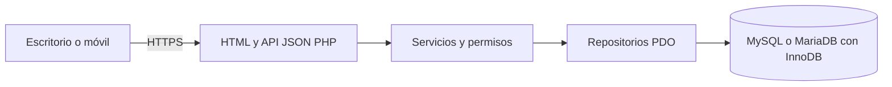

# AFEC Logística — análisis y propuesta para aprobación

Fecha: 14 de octubre de 2026. Estado: análisis previo a implementación.

Este documento propone arquitectura, modelo y fases. No autoriza ejecutar el SQL del handoff, modificar la planilla vigente ni desplegar la aplicación. No se ha implementado código de aplicación.

## 1. Diagnóstico del material recibido

### 1.1 Inventario y verificación

El directorio de trabajo contiene `AFEC_Logistica_Handoff_Codex.zip` y su carpeta extraída. Se leyeron completos sus 12 archivos: 11 documentos Markdown y un archivo SQL. Se compararon los archivos extraídos con las entradas del ZIP mediante SHA-256: los 12 coinciden. No se encontraron archivos adicionales de aplicación ni un repositorio Git inicializado en este directorio. Tampoco se encontraron instrucciones AGENTS.md en los directorios antecesores comprobados.

SHA-256 del ZIP: `54723B30ACC9490A0E19ACC397D90835CF1ECD8DAC7DEF15E2DCABFDC791BCA2`.

| Archivo del handoff | Contenido y evaluación |
| --- | --- |
| `README.md` | Explica la migración y advierte correctamente que no hay aplicación implementada ni fuentes verificadas de Terminal AFEC. |
| `AGENTS.md` | Requiere PDO, autorización backend, transacciones, idempotencia, historial por compensación, pruebas y rollback. Prohíbe alterar Sheets o producción sin aprobación explícita. |
| `PROMPT_CODEX.md` | Prioriza crear sistemas/instalaciones y que «Agregar cantidad» funcione en cualquier instalación nueva. Exige distinguir evidencia y propuestas. |
| `docs/01-requisitos.md` | Define el núcleo funcional y casos de borde. Permisos, sobreentregas y unidades siguen sujetos a validación. |
| `docs/02-arquitectura.md` | Describe un monolito PHP adecuado al objetivo. No acredita las capacidades del plan concreto de Hostinger. |
| `docs/03-modelo-datos.md` | Establece saldos derivados y movimientos compensatorios. Omite entidades separadas de comandantes/carriers y deja abierta la auditoría de objetivos. |
| `docs/04-api-ui.md` | Define vistas, rutas y flujo de carga. El JSON de ejemplo no permite identificar al comandante beneficiario ni al carrier. |
| `docs/05-migracion.md` | Propone snapshot, simulación, conciliación y corte. Faltan datos, claves de origen y criterios para recuperar un historial incompleto. |
| `docs/06-pruebas.md` | Aporta 15 criterios útiles; deben ampliarse con atribución, reversiones simultáneas, objetivos versionados y resultados de red ambiguos. |
| `docs/07-preguntas-abiertas.md` | Enumera 12 decisiones aún no resueltas. No deben convertirse automáticamente en reglas de negocio. |
| `docs/08-contexto-actual.md` | Recoge una inspección parcial y problemas comunicados, sin establecer causas verificadas. |
| `db/schema_propuesto.sql` | Borrador de seis tablas con InnoDB, claves foráneas, índices e idempotencia de movimientos. Es una buena base, pero insuficiente para el alcance solicitado. |

### 1.2 Fuentes que faltan y límites del diagnóstico

No están en el ZIP ni en el proyecto:

- `Code.gs`, que el README describe como un archivo de aproximadamente 48 KB disponible en una Biblioteca, con versión del 12/10/2026.
- `AFEC_Logistics_Sidebar.html` y el resto de archivos Apps Script: `Sidebar`, `Manager`, `Builder`, `Admin`, `Help` y cualquier archivo adicional.
- Exportación XLSX/CSV, fórmulas, metadatos, protecciones, hojas archivadas, historial y registros de errores de la planilla real.
- Fuentes o repositorio de Terminal AFEC.

Se intentó consultar en lectura la [planilla indicada en el README](https://docs.google.com/spreadsheets/d/14RxFS9FSc12ybmMuO95vFh8S9An0D4tdgDdEqT6ydEg/edit), pero la herramienta web devolvió que la URL no era accesible. Esto no permite concluir si el documento es público o privado. No hay un conector Drive disponible en esta sesión. La referencia a «Biblioteca» no proporciona aquí acceso a los archivos mencionados.

**Se ha analizado completamente el material entregado; no se ha auditado el sistema Apps Script ni validado sus datos.** No se puede declarar compatibilidad funcional completa, volumen de datos, calidad del historial ni causa raíz de sus fallos. La ausencia de Terminal AFEC no impide diseñar el monolito solicitado, pero impide afirmar reutilización de su código o sus convenciones.

### 1.3 Funcionamiento actual descrito, pendiente de verificar

La documentación describe una planilla organizada por sistemas e instalaciones, con requerimientos de mercancías, cantidades aportadas, comandantes y registros históricos. Apps Script aporta asistentes de creación y formularios de carga. El contexto menciona `showAFECManager()`, `showCreateSystemWizard()`, `showAppendInstallationWizard()`, `getAFECVersion()`, `getSheetMeta_`, `setSheetMeta_` y `getOrCreateSystemKey_`. Estas referencias proceden del handoff; no se han leído sus implementaciones.

La reconstrucción preliminar del flujo es: crear sistema → agregar instalación → definir objetivos → registrar cantidades → actualizar progreso e historial. Queda por determinar cómo se representan realmente los bloques de instalaciones, cómo se atribuyen los aportes y qué relación tienen los carriers con las cargas.

Al recibir las fuentes, la inspección deberá trazar cada acción desde el HTML hasta las funciones `.gs`, identificar rangos y metadatos usados, revisar bloqueos/concurrencia, protecciones, fórmulas y escritura del historial, y reproducir los errores con una copia aislada de Sheets.

### 1.4 Problemas comunicados y riesgos arquitectónicos

El handoff comunica fallos al agregar instalaciones, «Agregar cantidad» inoperante en instalaciones nuevas o ciertas filas, colores de finalización que no funcionan, conflictos con protecciones, nombres/filas duplicados y errores en el historial. **Son incidencias reportadas, no fallos reproducidos en esta revisión.**

El uso de filas, celdas y bloques visuales como referencia podría explicar fragilidad al insertar instalaciones, pero es una hipótesis hasta revisar código y metadatos. La nueva aplicación debe usar IDs persistentes y saldos separados por instalación/material; la posición visual no participa en las operaciones.

Las carencias verificadas del diseño entregado son:

1. **Usuario y comandante mezclados.** `movements.user_id` identifica una cuenta, pero no distingue al operador que registra de quien entrega. Importar aportes de terceros no debe obligar a crearles cuentas.
2. **Carriers ausentes.** Una nota libre no sustituye una relación verificable con un carrier.
3. **Objetivos sin historial.** `requirements.updated_at` no conserva cantidades anteriores, motivo ni autor. Cambiar el objetivo modifica el porcentaje actual sin poder reconstruir su contexto histórico.
4. **Reversiones insuficientemente restringidas.** La FK al movimiento original no impide dos reversiones, una compensación de material distinto o una cantidad incorrecta. Hace falta validación transaccional y una restricción de unicidad si se aprueba reversión completa única.
5. **Idempotencia parcial.** La clave única solo protege movimientos; no cubre creación de instalaciones, cambios de objetivos ni una corrección compuesta. Tampoco identifica la reutilización de una clave con contenido distinto.
6. **Origen de importación ausente.** El esquema no permite rastrear filas fuente, ejecuciones de importación ni conflictos entre snapshots.
7. **Fechas incompletas.** `recorded_at` no distingue fecha de entrega de fecha de registro/importación. Deben preservarse fechas ambiguas sin adivinarlas.
8. **Progreso agregado indefinido.** No hay regla acordada sobre ponderación, sobrantes, objetivos cero e instalaciones archivadas.
9. **Reglas y catálogo incompletos.** No están cerrados los estados, tipos de instalación, aliases, permisos ni unidades. La unicidad de nombres y la colación requieren contrastarse con datos reales.
10. **Operación sin preparar.** Faltan Git, entorno de pruebas, configuración de Hostinger, política de backups/restauración y proceso de publicación. Son pendientes de preparación, no requisitos para reescribir el frontend con otro stack.

## 2. Arquitectura propuesta para aprobar

### 2.1 Decisión estructural

Un monolito modular con PHP, PDO y MySQL/MariaDB, plantillas HTML, CSS responsive y JavaScript vanilla. HTML y API JSON se sirven desde el mismo dominio por HTTPS. Un despliegue y una base de datos. PHP controla toda lectura y escritura autorizada.



Propongo **PHP 8.4 como base**, con parche actualizado y versión efectiva confirmada en Hostinger; 8.5 también es una opción si se selecciona y verifica desde el inicio. El mínimo 8.2 del handoff tiene poco margen para una aplicación nueva: su soporte de seguridad termina el 31/12/2026, frente al 31/12/2028 de 8.4. Esta elección se basa en el [calendario oficial de PHP](https://www.php.net/supported-versions.php). Hostinger documenta la selección de versión en hPanel, pero eso no confirma lo habilitado en esta cuenta ni la versión de base de datos: [configuración PHP en Hostinger](https://www.hostinger.com/support/1575755-how-to-change-the-php-version-of-your-hostinger-hosting-plan/).

La versión exacta de MySQL o MariaDB se fijará al verificar el hosting. Se usará su conjunto común de capacidades: InnoDB, claves foráneas, índices y SQL preparado. La colación debe existir en ambos motores elegidos; no se asumirá una colación exclusiva de MySQL 8. Los `CHECK` serán una defensa adicional cuando se confirme su soporte, junto con validación de servidor.

Las páginas tendrán HTML inicial generado por PHP. JavaScript añadirá filtros y formularios con `fetch`, estados de carga y actualización de progreso. No hacen falta React, Vite, Node.js, servicios externos ni procesos permanentes. No se propone añadir un framework ni una dependencia de producción en esta etapa.

### 2.2 Responsabilidades

| Parte | Responsabilidad |
| --- | --- |
| Rutas/controladores | Interpretar solicitud, validar formato, comprobar sesión/CSRF y devolver HTML o JSON. |
| Servicios | Aplicar permisos y reglas de negocio; coordinar transacciones, compensaciones, auditoría e idempotencia. |
| Repositorios PDO | Ejecutar SQL preparado, cargar registros y agregar saldos. No decidir permisos. |
| Plantillas y JS | Presentar datos, validar para ayudar al usuario y enviar IDs. El backend vuelve a validar todo. |
| Importador | Validar y mapear snapshots, producir simulaciones y registrar procedencia. Sin editar Sheets. |

Se evitarán repositorios genéricos, motores de workflows y capas sin una función concreta. Las consultas de progreso preagregarán los movimientos antes de combinar tablas para impedir multiplicar sumas por joins. Historial paginado y consultas de resumen por lotes; sin una consulta por cada celda. Inicialmente no se almacenarán contadores de saldo ni porcentajes como autoridad. Una optimización posterior deberá justificarse con mediciones reales.

### 2.3 Directorios y despliegue

Estructura propuesta, todavía no creada:

```text
afec-logistica/
├── public/
│   ├── index.php
│   ├── api/index.php
│   └── assets/{css,js,img}/
├── src/
│   ├── bootstrap.php
│   ├── Http/{Controllers,Router.php,JsonResponse.php}/
│   ├── Security/{Auth.php,Authorization.php,Csrf.php}/
│   ├── Services/{SystemService.php,InstallationService.php,MovementService.php,
│   │             RequirementService.php,ImportService.php}/
│   ├── Repositories/
│   └── Validation/
├── templates/{layout.php,systems,installations,history,admin}/
├── config/{config.example.php,config.php}
├── database/{migrations,seeds}/
├── storage/{logs,imports,reports}/
├── tools/
├── tests/{integration,acceptance}/
└── docs/
```

`config.php`, snapshots y logs serán privados y quedarán excluidos de Git. El archivo de ejemplo no tendrá secretos. En el hosting, preferentemente el document root apuntará a `public/`. Si se usa `public_html` fijo, se copiará allí únicamente el contenido público y el resto quedará fuera, con rutas configuradas. Si el plan no permite ese aislamiento, se deberán comprobar reglas de denegación en el servidor real antes de publicar; no se dará por hecho que un `.htaccess` aplica a cualquier servidor.

El router podrá usar rutas limpias si el hosting lo admite y una variante `api/index.php?route=...` si es necesario. No dependerá de SSH, Composer, cron ni un runtime Node para atender solicitudes. La ejecución de migraciones y backups se acordará según las capacidades verificadas; no se dejará un instalador o migrador público permanente.

### 2.4 Seguridad y funcionamiento de la API

- PDO con parámetros para valores; nombres de columnas, ordenaciones y filtros estructurales mediante listas permitidas. Errores por excepciones, conexión `utf8mb4` y preparaciones nativas cuando proceda. Referencia: [manual de consultas preparadas PDO](https://www.php.net/manual/en/pdo.prepared-statements.php).
- Sesiones PHP privadas, cookies `Secure`, `HttpOnly`, `SameSite=Lax`, modo estricto y regeneración de identificador al autenticar. Caducidad por inactividad y absoluta controlada por la aplicación. Revalidación de usuario activo y permisos en cada solicitud; revocación tras cambios de contraseña/rol. Referencia: [seguridad de sesiones PHP](https://www.php.net/manual/en/session.security.ini.php).
- `password_hash`/`password_verify`, contraseñas sin registrar en logs, errores de login genéricos y limitación de intentos sin servicio externo. Altas y recuperación administradas son una propuesta pendiente, no una decisión aprobada.
- Token CSRF independiente de la sesión en operaciones de escritura, login y logout. Ninguna mutación por GET. API del mismo origen, sin abrir CORS innecesariamente.
- Autorización backend por acción y recurso. Una cuenta de lectura no podrá escribir llamando la API directamente. Si se aprueba carga propia, el backend restringirá también el comandante elegido.
- Escapado contextual de texto en HTML y uso seguro del DOM; cantidades, longitudes, fechas, IDs y estados validados. Mensajes públicos sin stack traces ni credenciales.
- Credenciales SQL de aplicación con privilegios mínimos. El historial no tendrá endpoints de edición/borrado. Cuando el hosting permita permisos por tabla, se restringirá UPDATE/DELETE sobre movimientos y auditoría; no se confundirá esto con protección contra un administrador de base de datos privilegiado.
- Todas las mutaciones funcionales usarán una clave de idempotencia y un hash del contenido normalizado. Igual clave/contenido devuelve el resultado original; igual clave/contenido distinto devuelve conflicto. No se deduplicarán automáticamente dos entregas legítimas solo por coincidir comandante/material/cantidad.

La respuesta JSON tendrá campos consistentes para resultado, error de validación e identificador de operación. Las rutas del handoff se mantienen como base, añadiendo comandantes/carriers y una corrección atómica. Estados previstos: 401 sin sesión válida, 403 sin permiso, 404 recurso inexistente, 409 conflicto/idempotencia/versión, 422 datos inválidos y 500 error interno registrado.

En «Agregar cantidad», el usuario elegirá material, comandante cuando tenga permiso, cantidad, fecha si se aprueba y carrier opcional. El actor se obtiene de la sesión. La clave se conserva mientras el resultado de esa operación sea incierto. Un timeout no implica que la entrega falló: se reconsulta o reintenta con la misma clave. Tras el éxito se muestran los saldos devueltos por el servidor. Los controles usan IDs y eventos aplicables también a instalaciones recién creadas.

### 2.5 Permisos propuestos, aún sujetos a aprobación

| Acción | Administrador | Operador | Lector |
| --- | --- | --- | --- |
| Consultar progreso e historial permitido | Sí | Sí | Sí |
| Registrar entregas | Sí | Sí | No |
| Crear sistemas/instalaciones | Sí | Por confirmar | No |
| Editar objetivos, catálogo o archivar | Sí | Por confirmar | No |
| Revertir/corregir | Sí | Por confirmar | No |
| Gestionar usuarios y roles | Sí | No | No |

El posible visitante público constituye otra política de lectura pendiente. No se publicará historial con identidades por defecto sin decidir su alcance. Un conjunto fijo de roles y una matriz en código bastan inicialmente; no se propone un editor genérico de permisos.

## 3. Esquema relacional inicial

El siguiente diseño cubre el alcance expresado. Es una propuesta de entidades, columnas y restricciones, **no un DDL ejecutado ni un modelo ya validado contra Sheets**. Las PK serán IDs internos; unidades enteras y estados concretos deben confirmarse antes de cerrar migraciones.

### 3.1 Tablas funcionales

| Tabla | Columnas principales y relaciones |
| --- | --- |
| `users` | `id`, `username` único, `display_name`, `password_hash`, `role`, `active`, `commander_id` opcional FK, `auth_version`, `created_at`, `updated_at`. Una cuenta autentica al actor; no todos los comandantes necesitan cuenta. La cardinalidad cuenta/comandante queda por confirmar. |
| `commanders` | `id`, `display_name`, `normalized_name`, `active`, fechas. Normalización para detectar candidatos duplicados; fusiones/unicidad solo después de verificar identidades. |
| `carriers` | `id`, `code` si existe identificador fiable, `name`, `active`, fechas. No se asume dueño único ni inventario a bordo. Unicidad del código a validar con origen. |
| `systems` | `id`, `name`, clave normalizada o externa si es fiable, `description`, `archived_at`, `version`, fechas. La unicidad por nombre debe validarse con datos/collation. |
| `installations` | `id`, `system_id` FK, `name`, `body_name`, `location_label`, `tier`, `type` si se confirma, `state`, `sort_order`, `archived_at`, `version`, fechas. Nombres repetidos no se rechazan sin regla validada. |
| `commodities` | `id`, `code` único, `name_es`, `name_en` opcional, `active`, fechas. Alias adicionales se preservarán en el mapping; si son funcionales se añadirá una tabla de aliases tras revisar origen. |
| `requirements` | PK (`installation_id`, `commodity_id`), ambas FK; `required_quantity`, `active`, `version`, `updated_at`. Una sola meta actual por pareja. Desactivar conserva referencias e historial. |
| `requirement_revisions` | `id`, pareja FK, `revision_number`, cantidad/estado anterior y nuevo, `actor_user_id` FK, `reason`, `operation_id` FK, `recorded_at`. Incluye la creación inicial y cada modificación; UNIQUE por pareja/revisión. |
| `movements` | `id`, pareja FK a requerimiento, `actor_user_id` FK, `commander_id` FK, `carrier_id` FK opcional, `delta_quantity` firmado, `movement_type`, `reverses_movement_id` FK opcional, `operation_id` FK, `entry_number`, `occurred_at` opcional, `recorded_at`, `reason`/`note`, referencia de importación opcional y atribución legacy cuando sea necesaria. |

Una entrega nueva requiere comandante. Para un dato histórico cuya identidad no sea recuperable, el comandante podrá ser NULL bajo un tipo de importación explícito, con el texto original y la incidencia registrados. No se atribuirá al importador una entrega que no realizó. `actor_user_id` registra quién ejecuta la operación/importación ahora; el autor histórico, si existe, se conserva como procedencia, sin falsificar cuentas.

`occurred_at` expresa cuándo ocurrió la entrega, cuando se conoce; `recorded_at` indica cuándo se registró en la aplicación. Fechas nuevas se guardan en UTC y se muestran en la zona acordada. Valores históricos ambiguos conservan el texto fuente y quedan pendientes de resolución; no se les asigna una hora precisa inventada.

### 3.2 Tablas de soporte

| Tabla | Propósito y restricciones principales |
| --- | --- |
| `operations` | `id`/UUID, `actor_user_id`, `scope`, `idempotency_key`, `request_hash`, referencia/resultado mínimo y fecha. UNIQUE (`actor_user_id`, `scope`, `idempotency_key`). Una operación puede crear varias filas compensatorias. Sin passwords ni tokens en sus contenidos. |
| `audit_log` | `id`, `actor_user_id`, acción, entidad/ID, valores anteriores/nuevos permitidos, motivo, `operation_id`, fecha. Registra cambios de usuarios, sistemas, instalaciones, catálogo y archivo. No duplica innecesariamente el detalle del ledger ni contiene secretos. |
| `import_runs` | `id`, fuente lógica, hash de snapshot, versión de mapping, operador, fecha, estado, conteos y ubicación privada del informe. Registra ejecuciones e incidencias sin alterar el origen. |
| `import_items` | `id`, `import_run_id`, dataset, entidad/tipo, clave estable de origen, localizador en snapshot, hash de contenido y referencia de destino. UNIQUE por dataset/tipo/clave estable. Datos rechazados se conservan en el informe. |
| `schema_migrations` | Versión SQL aplicada, checksum y fecha. Control de esquema sin framework de migración obligatorio. |

Las tablas de soporte permiten auditoría, reintentos y migración reproducible; no son servicios adicionales. El esquema tiene nueve tablas funcionales y cinco de soporte. Las que solo hacen falta para importar se incorporan en esa fase. El detalle de cada DDL se cerrará con la versión de motor y los datos reales.

### 3.3 Integridad, índices y actualización concurrente

- InnoDB y `utf8mb4`; IDs/FK del mismo tipo y acciones de borrado restrictivas. Sistemas, instalaciones, requerimientos, cuentas y catálogos se archivan/desactivan si ya tienen referencias. No se propone borrado físico rutinario.
- Índices: instalaciones por sistema/archivo; movimientos por pareja/fecha/ID, por comandante/fecha, por carrier/fecha cuando se use, por operación, y por referencia de reversión; auditoría por entidad/fecha. El diseño final se validará con consultas y volúmenes reales.
- `required_quantity` no negativa; `delta_quantity` firmado y distinto de cero. Entregas ordinarias positivas, compensaciones negativas. Límites de cantidad compatibles con enteros de PHP/SQL y con la precisión de JSON; se fijará un máximo de negocio verificado o se representarán cantidades como cadenas decimales si exceden el rango seguro de JavaScript. No se asumirá que BIGINT cabe exactamente en un Number.
- Una revisión de objetivo se escribe en la misma transacción que su actualización. Un campo `version` impide que una edición basada en datos antiguos sobrescriba silenciosamente otra edición.
- Si se aprueba reversión completa única: UNIQUE (`reverses_movement_id`), origen elegible y misma pareja/atribución, delta exactamente opuesto y motivo obligatorio. La FK por sí sola no garantiza estas condiciones. Reversiones parciales necesitan otra regla y no se darán por aprobadas.
- Corrección de cantidad o atribución: servicio único que compensa el original y registra el reemplazo en una misma operación/transacción. Si falla cualquier paso no queda una corrección parcial. No se edita el movimiento original.

### 3.4 Transacción de entrega o corrección

Orden propuesto:

1. Validar sesión, permiso, CSRF, formato y referencias; resolver atribución autorizada.
2. Abrir transacción PDO y reservar la operación con su clave/hash. Si ya se confirmó, devolver el mismo resultado tras volver a comprobar acceso. Si otro intento está en curso, resolver por la restricción única y un reintento controlado.
3. Bloquear el requerimiento correspondiente con `SELECT ... FOR UPDATE`. Todos los escritores del saldo y de objetivos deben respetar ese mismo bloqueo. Para varias parejas, adquirirlas en orden fijo.
4. Leer el saldo actualizado bajo una estrategia de aislamiento consistente. Propuesta inicial: transacciones de escritura `READ COMMITTED`, verificadas en el motor real; el bloqueo del requerimiento serializa los escritores de esa pareja. No basta con bloquear una fila y sumar desde una lectura antigua.
5. Validar reglas acordadas de cantidades, archivo, saldo, reversión y sobreentrega. Para revertir, bloquear/comprobar también el original.
6. Insertar movimiento(s), revisiones/auditoría necesarias y resultado de operación; confirmar. Ante error, hacer rollback. Deadlocks/timeouts de bloqueo: reintento limitado con la misma clave; sin duplicar resultados.

El ledger es la fuente de los totales. Un timeout del navegador tras commit se resuelve recuperando la operación, no enviando una entrega nueva. El bloqueo y la restricción única se probarán con dos conexiones y usuarios distintos. Referencias: [transacciones PDO](https://www.php.net/manual/en/pdo.transactions.php) y [lecturas con bloqueo de InnoDB](https://dev.mysql.com/doc/refman/8.0/en/innodb-locking-reads.html). La estrategia equivalente se comprobará contra la versión MariaDB si ese es el motor contratado.

### 3.5 Cálculo de progreso propuesto

Para cada pareja instalación/material:

```text
entregado_neto = SUM(delta_quantity)
restante = MAX(requerido - entregado_neto, 0)
sobrante = MAX(entregado_neto - requerido, 0)
cubierto = MIN(MAX(entregado_neto, 0), requerido)
porcentaje = 100 * cubierto / requerido        (si requerido > 0)
```

Para instalación/sistema, propongo `100 * SUM(cubierto) / SUM(requerido)` sobre requerimientos incluidos. Así, un sobrante de un material no compensa otro faltante ni produce un 100% engañoso. Ejemplo: dos materiales requieren 100 cada uno; se entregan 200 del primero y 0 del segundo. El progreso propuesto es 50%, con sobrante 100 y faltante 100.

Es una ponderación por unidades, no por precio, dificultad ni Construction Points. **Debe aprobarse**. Si el denominador es cero, propongo «Sin objetivos definidos», con porcentaje NULL. No se ocultará un saldo negativo histórico ajustándolo a cero: se mostrará como incidencia; la política de nuevas operaciones queda pendiente. Las vistas actuales y las históricas explicitarán su criterio de inclusión de instalaciones archivadas. «Completo» calculado y estado operativo de instalación serán datos distintos.

## 4. Funcionalidades por prioridad

| Prioridad | Alcance | Motivo/criterio de salida |
| --- | --- | --- |
| P0 — validación | Fuentes reales, reglas de entrega/carrier, permisos, hosting y mapping | Permite cerrar el modelo y evitar convertir hipótesis en comportamiento. |
| P1 — núcleo | Sesiones/roles; sistemas; instalaciones; catálogo/requisitos; comandantes; carrier opcional; «Agregar cantidad»; progreso y ledger | Una instalación recién creada admite entregas correctas, separadas de otras instalaciones y sin duplicaciones por retry. |
| P1 — integridad | Reversión/corrección; objetivos versionados; archivo; autorización; auditoría; concurrencia; backups/restauración | Parte del mínimo antes de manejar datos reales en producción. |
| P1 — transición | Simulación e importación idempotente, conciliación y corte probado | Obligatorio para sustituir Sheets conservando datos y trazabilidad. Puede desarrollarse junto al núcleo una vez estable el mapping. |
| P2 — operación | Filtros avanzados, CSV de historial/progreso, orden/prioridad visual si se confirma, mejoras de administración | Mejora el trabajo habitual tras validar el flujo principal. La exportación necesaria para rollback se prepara antes del corte. |
| P3 — ampliación | Integraciones Frontier/Inara, recetas automáticas, notificaciones, inventario de carriers, Construction Points | Fuera del alcance inicial salvo aprobación explícita. |

Responsive, validación y mensajes claros forman parte de cada entrega, no una fase cosmética final. Se conserva la señal visual de progreso/finalización y se añade texto/porcentaje para no depender únicamente del color.

## 5. Migración segura de datos

### 5.1 Preparación y simulación

1. Obtener snapshot íntegro de Sheets y de Apps Script, con fecha, zona horaria, checksum y copia verificable. XLSX preserva fórmulas/estructura mejor que CSV aislado, pero no sustituye el respaldo de scripts, metadatos y protecciones. Documentar estos elementos aparte.
2. Inventariar todas las hojas, incluso ocultas/archivadas, bloques, fórmulas, valores calculados, totales e historial. Identificar cuál es la fuente de verdad de cada cantidad.
3. Crear un mapping versionado: claves antiguas de sistema/instalación/material/comandante/carrier → IDs nuevos. Usar metadatos/IDs fiables cuando existan. Una fila es un localizador dentro de un snapshot, no una identidad estable entre exportaciones.
4. Simular sin escribir en la base de destino. Informar registros válidos, rechazados, duplicados candidatos, aliases, cantidades/fechas ambiguas, claves faltantes y diferencias entre historial y totales visibles. No fusionar identidades ni corregir discrepancias automáticamente.
5. Aprobar el informe y sus excepciones antes de importar datos reales. Ensayar inicialmente con datos sintéticos o muestras anonimizadas identificadas como tales.

### 5.2 Historial completo o incompleto

Si existe historial completo y fiable, se importan los movimientos con procedencia y atribución. Las sumas se comparan contra el snapshot. Si solo hay agregados, se podrá representar un **saldo inicial importado** explícito por pareja y conservar el archivo original; no crear entregas detalladas, autores o fechas ficticios. Si hay historial parcial, la diferencia entre histórico conocido y total debe resolverse y aprobarse antes de crear cualquier saldo de apertura.

El tipo/importador debe distinguir una entrega recuperada de un agregado inicial. La palabra `import` sola, sin procedencia y clasificación, no explica qué se conoce del dato.

### 5.3 Idempotencia y conciliación

- Un snapshot tiene checksum, pero el checksum no basta para deduplicar movimientos entre dos snapshots distintos. Hace falta una clave estable de cada evento de origen o una reconciliación explícita.
- Reimportar la misma clave/hash omite lo ya aplicado. La misma clave con datos distintos produce conflicto y un informe; no sobrescribe el ledger.
- No se considerarán duplicados dos entregas solo por compartir valores y hora. Si no hay ID estable, se conservará la ambigüedad y se establecerá un procedimiento manual o se repetirá la carga final en una base vacía de destino.
- Importación por transacción o por lotes trazables, según volumen/límites. Lotes parciales quedan identificados y reanudables. Sin tablas/migraciones DDL mezcladas con transacciones de datos.
- Conciliar conteos de entidades, requerimientos, entregas/compensaciones y sumas por pareja, comandante y carrier cuando el origen permita hacerlo. La comparación debe contemplar objetivos y movimientos negativos; comprobar solo el total global no es suficiente.
- Todas las diferencias quedan resueltas o aceptadas por escrito. Informe con checksum, versión de mapping, conteos y muestras revisadas.

### 5.4 Corte y rollback

Primero se ensaya la restauración en un entorno aislado y se acuerdan responsable, ventana y tiempo máximo de indisponibilidad. Se respalda MySQL y se conserva la versión anterior del código. En la ventana de corte se congelan escrituras en Sheets con aprobación explícita, se genera snapshot final y se concilia antes de habilitar escritura en la web.

Un delta entre snapshots solo se admite con identificadores fiables. Si faltan, se puede reconstruir el destino desde el snapshot final en una base limpia, conservando la base de ensayo para consulta y evitando mezclar aportes de prueba. Durante el corte solo habrá un sistema aceptando escrituras.

Si se decide volver a Sheets después de aceptar entregas nuevas, se detienen las escrituras web, se respaldan/exportan esos movimientos y se reconcilian una sola vez con la planilla antes de reabrirla. El rollback no es una sincronización bidireccional automática. Una instalación o base de ensayo puede descartarse; datos de producción ya aceptados no se descartan para volver al estado anterior.

Para cambios de esquema, el rollback no se basará únicamente en `PDO::rollBack`: MySQL puede confirmar implícitamente operaciones DDL. Se prefieren cambios compatibles y backups/restauración probados, según el [manual PDO sobre commits implícitos](https://www.php.net/manual/en/pdo.transactions.php).

## 6. Plan de implementación por fases

Estas fases empiezan únicamente tras aprobar este análisis. Antes de cada fase se presentarán alcance breve, archivos afectados, comprobaciones, riesgos y rollback conforme a AGENTS.md. El esfuerzo es relativo; no hay base para prometer días hasta conocer datos y hosting.

| Fase | Resultado y archivos previstos | Verificación para aceptar | Riesgo y rollback | Esfuerzo relativo |
| --- | --- | --- | --- | --- |
| 0. Completar evidencia y decisiones | Fuentes originales en ubicación acordada; `docs/inventario-origen.md`, mapping y registro de decisiones. Verificar Hostinger. | Trazado de los flujos reales, identificación de histórico y datos, matriz de permisos aprobada. | Falta de fuentes o reglas. Sin cambios en producción; revisar documentos/mapping. | Bajo–medio, dependiente de disponibilidad. |
| 1. Base del monolito | Git y primer punto de restauración; `public/`, bootstrap, configuración, conexión PDO, migraciones base, autenticación y permisos. | Login/logout, CSRF, 401/403, cuentas desactivadas y secretos inaccesibles desde web. Instalación limpia en staging. | Configuración de rutas/hosting. Restaurar versión/base de staging; producción intacta. | Medio. |
| 2. Sistemas e instalaciones | Servicios/repositorios, plantillas, catálogo, comandantes/carriers, requerimientos con revisiones y auditoría. | Crear sistema e instalación con dos materiales; editar/archivar conservando referencias; detectar ediciones concurrentes. | Identidades o metas mal mapeadas. Corregir en staging o restaurar snapshot. | Medio. |
| 3. Entregas y progreso | `MovementService`, operaciones idempotentes, endpoints, formulario responsive y consultas agregadas. | Instalación nueva acepta carga; dos operadores conservan ambos aportes; timeout/retry/doble clic crea uno; saldos separados y fórmulas correctas. | Duplicación/pérdida por concurrencia. Corregir mediante compensación en datos reales; rollback de versión compatible. | Medio–alto. |
| 4. Correcciones y administración | Reversión/corrección atómica, historial filtrable, permisos definitivos, administración y exportación necesaria para recuperación. | Doble reversión simultánea; motivo obligatorio; autorización de comandante/carrier; originales preservados y auditoría de objetivos. | Compensación o permisos erróneos. Nueva compensación trazable; detener escrituras si hace falta; nunca borrar evidencia. | Medio. |
| 5. Migración y ensayo operativo | `ImportService`, herramientas, `import_runs/items`, informes y manual de backup/corte/rollback. | Dry-run, segunda importación sin duplicar, claves en conflicto detectadas, conciliación por pareja, restauración aislada y pruebas móviles/seguridad. | Origen incompleto o límites del hosting. Restaurar ensayo; no habilitar producción con discrepancias sin resolver. | Alto y variable según calidad de origen. |
| 6. Corte controlado | Paquete verificable, snapshot final, informe de aceptación y despliegue. | Aprobación explícita del corte; fuente única de escritura; prueba de humo y conciliación final. | Movimientos en ventana/cambios de esquema. Congelar, exportar/reconciliar lo nuevo, restaurar código/base con procedimiento acordado. | Ejecución breve, preparación crítica. |
| 7. Mejoras posteriores | CSV de uso habitual, filtros/prioridad y rendimiento medido; integraciones solo con nuevo alcance. | Cada mejora con criterio y prueba proporcionales. | Crecimiento de complejidad. Fases pequeñas y versiones compatibles. | Según prioridad. |

Las fases 1–4 constituyen un MVP verificable en staging; no equivalen a estar listo para reemplazar Sheets. Las fases 5–6 son necesarias para el uso real con los datos existentes. La migración puede investigarse en paralelo al diseño funcional, pero no se ejecutará contra datos reales sin validar su informe.

## 7. Pruebas y criterios de aceptación ampliados

Se mantienen los 15 casos de `docs/06-pruebas.md`, con comprobaciones reproducibles sobre la versión de MySQL/MariaDB seleccionada. SQLite no demostraría el comportamiento real de bloqueos/FK/concurrencia de ese motor.

Además se comprobarán:

1. Usuario que registra ≠ comandante que entrega; asociación de carrier correcta y restricciones según permiso. El cliente no puede imponer el actor.
2. Repetición de la misma operación con contenido diferente devuelve conflicto. Dos operaciones legítimas iguales con claves distintas no se eliminan por similitud.
3. Dos reversiones concurrentes del mismo original; fallo entre compensación y reemplazo; intento de revertir otro material o compensar más de lo permitido.
4. Cambio de objetivo simultáneo a entrega; edición con versión obsoleta; historial de la meta anterior y motivo preservados.
5. Sobreentrega de un material sin ocultar faltantes de otro; requerimientos cero; desactivación y archivo con historial consultable.
6. Respuesta perdida después de commit; retry de red con misma clave; deadlock controlado y ausencia de éxito simulado.
7. Importación de historial completo, parcial y solo agregado; fechas/identidades desconocidas explícitas; segunda importación y snapshot diferente sin duplicados silenciosos.
8. Acceso directo a config/snapshots/logs denegado; SQLi/XSS/CSRF; rol o usuario desactivado durante sesión; límites de login.
9. Móvil con formulario usable y feedback de error; lista/historial paginados; tiempos medidos con volumen real antes de fijar un umbral de rendimiento.
10. Restauración y conciliación de movimientos posteriores al corte ensayadas con responsable y pasos documentados.

En esta etapa solo se verificaron lectura completa, inventario y coincidencia ZIP/carpeta. No hay pruebas de aplicación ejecutadas porque no hay aplicación. El SQL propuesto no se ha ejecutado.

## 8. Riesgos, dependencias y decisiones pendientes

### 8.1 Riesgos y dependencias

| Riesgo/dependencia | Impacto | Tratamiento |
| --- | --- | --- |
| Fuentes Apps Script y export no disponibles | No se puede garantizar conservación de todos los flujos ni cerrar mapping. | Incorporar proyecto completo y snapshot antes de compatibilidad/migración. |
| Historial incompleto o contradictorio | No se puede reconstruir autoría/fechas/total confiable por intuición. | Informe de diferencias; saldo inicial explícito solo tras aprobación; preservar origen. |
| Cuenta/comandante/carrier confundidos | Atribución o progreso incorrectos. | Entidades separadas; fijar significado de cada carga. |
| Falta de IDs estables en origen | Importación incremental puede duplicar eventos. | Mapping validado, claves persistentes si existen o reconstrucción final limpia; no usar número de fila entre snapshots. |
| Plan y motor Hostinger no verificados | Rutas, extensiones, backups o bloqueos distintos a lo esperado. | Comprobar PHP/PDO, motor/versiones, HTTPS, aislamiento, recursos y restauración en staging. |
| Concurrencia/reintentos/reversiones | Duplicación o saldos inválidos. | Transacciones, bloqueos comunes, idempotencia y restricciones con pruebas concurrentes. |
| Cambios de objetivos/archivo | Porcentajes engañosos o pérdida de contexto histórico. | Revisiones obligatorias y criterio de inclusión explícito. |
| Doble escritura durante transición | Divergencia y rollback difícil. | Freeze aprobado, fuente única, conciliación final y recuperación de aportes nuevos. |
| Sin Git ni proceso de publicación | Rollback de código difícil. | Inicializarlo tras aprobación y versionar cada fase sin secretos. |

Terminal AFEC es una referencia opcional: su ausencia impide auditar semejanza/reutilización, pero no bloquea el stack solicitado. Las fuentes de Sheets y los datos sí son una dependencia para afirmar equivalencia y migrar con seguridad.

### 8.2 Decisiones necesarias antes de cerrar el núcleo

1. **Lectura:** pública o con login; si es pública, qué historial e identidades se exponen.
2. **Roles:** quién crea sistemas/instalaciones, modifica objetivos, archiva, gestiona catálogo y revierte. Permisos globales o restringidos por sistema.
3. **Atribución:** carga propia, operador en nombre de terceros o ambas; posibilidad de comandante sin cuenta; relación entre una cuenta y uno o varios comandantes.
4. **Significado de la carga/carrier:** entrega recibida por instalación, material embarcado o ambos. Si se registran embarques, no se sumarán a progreso como entregas y requerirán un flujo adicional aprobado. Definir qué representa el carrier elegido.
5. **Cantidades y correcciones:** unidades enteras, límites, sobreentregas, saldos negativos, reversión completa o parcial y autorización para cada caso. La propuesta mínima es reversión completa + reemplazo atómico; pendiente de aprobación.
6. **Progreso:** ponderación por unidades, sobrantes separados, objetivos cero, inclusión de archivadas y significado del estado operativo/completo.
7. **Instalaciones:** tipos, tiers, estados válidos, prioridad y posibles atributos adicionales. Construction Points sigue fuera de alcance salvo cambio expreso.
8. **Identidades y catálogo:** claves de sistema/material/carrier y criterios de unicidad/fusión de comandantes; cambios de nombres y aliases existentes.
9. **Cuentas:** usuario o email, alta por administrador/invitación, recuperación, caducidad de sesiones y quién será administrador inicial.
10. **Operación:** plan Hostinger, versiones/extensiones, subdominio, aislamiento privado, backups, responsable y disponibilidad de herramientas de migración. Confirmar si comparte recursos/versiones con Terminal AFEC.
11. **Origen:** exportación completa, volumen, fuentes de fórmulas/metadatos y fiabilidad del historial. Zona horaria original y tratamiento de fechas.
12. **Corte:** ventana, congelación de Sheets, período de conservación y tiempos de recuperación acordados.

### 8.3 Qué se solicita aprobar ahora

La aprobación de este análisis habilitaría completar la fase 0 y, una vez resueltas sus dependencias, iniciar las fases del monolito descritas. No implica elegir respuestas a las decisiones abiertas ni autoriza un corte en producción. La propuesta estructural puede aprobarse aunque Terminal AFEC no esté disponible; el modelo detallado y la migración se cerrarán con la evidencia real.

Hasta recibir aprobación, el trabajo queda en documentación. No se modifica la planilla, no se ejecuta el esquema y no se desarrolla la aplicación.
